

  

<h1 align="center">Cross-Com Enhanced</h1>

  <b>Community servers for <i>Tom Clancy's Ghost Recon: Future Soldier</i> multiplayer, and a launcher that sets the game up for you.</b> 
  Every adversarial mode, Guerrilla and co-op, years after the official servers went dark.

  <a href="#test-builds"><b>Test builds</b></a> ·
  <a href="#the-community-test-network">Community test network</a> ·
  <a href="#play">Play</a> ·
  <a href="#what-works">What works</a> ·
  <a href="#reporting-a-problem">Report a problem</a> ·
  <a href="#host-a-server">Host a server</a> ·
  <a href="https://github.com/JDevWebb/cross-com-enhanced/wiki">Wiki</a> ·
  <a href="#documentation">Docs</a> ·
  <a href="#contributing">Contribute</a>

---

## Test builds

> [!IMPORTANT]
> **Cross-Com Enhanced is in public testing: each [release](https://github.com/JDevWebb/cross-com-enhanced/releases/latest) is a test build.** Every mode has been played end to end on real copies of the game, on Windows 11 and under Wine on Linux, between home networks over the internet. Expect rough edges: things may break, and servers may be reset between builds. **Your reports are what these builds are for**: see [Reporting a problem](#reporting-a-problem).

What that means for you:

- **Logs are sent to the server after each game you play online**, so problems can be found without you having to describe them. What's sent and how to turn it off: [What's sent, and when](#whats-sent-and-when).
- **Accounts and stats may be reset** before a later build. Don't get attached to your leaderboard rank yet.
- **Microsoft Defender removes the launcher** as soon as it's downloaded, calling it `Trojan:Win32/Bearfoos.B!ml`. That's a false positive: the files aren't code-signed yet. [Antivirus warnings](#antivirus-warnings) says how to check the download and get it back.

## The community test network

**There is a community test network that anyone can play on, for free: `grfs-test.jdevwebb.net`.** It's the launcher's default, so there's nothing to type: everyone testing signs in to the same server, so every Quick Match search finds the other testers. It runs this test build, and it may be reset between builds.

<table>
<tr><td><b>Address</b></td><td><code>grfs-test.jdevwebb.net</code>: the launcher's default</td></tr>
<tr><td><b>Modes</b></td><td>Every adversarial mode, ranked and player matches, the campaign and Guerrilla in co-op</td></tr>
<tr><td><b>Your account</b></td><td>Made in the launcher, the first time you play: you choose a name, and there's no password (see <a href="#your-identity">Your identity</a>)</td></tr>
<tr><td><b>Logs</b></td><td>Each online game's log goes to the network, so problems can be found (see <a href="#whats-sent-and-when">What's sent, and when</a>)</td></tr>
</table>

To play on another server (your group's own, or one on your LAN), see [Play](#play).

## Play

You need **Ghost Recon: Future Soldier on PC** (Ubisoft Connect or Steam) on Windows 10 or 11.

1. **Download** `crosscom-launcher.exe` from the [latest release](https://github.com/JDevWebb/cross-com-enhanced/releases). It's one file: keep it in a folder of your own, such as your Desktop or Documents (not Program Files), so it can update itself.
2. **Run it.** It finds the game by itself (Ubisoft Connect and Steam installs, or a folder you choose), and the [community test network](#the-community-test-network) is already picked.
3. **Make an account**: choose the name other players will see. There's no password: your [identity](#your-identity) signs you in, and if it already has an account on the server, the launcher signs you in to it with nothing to type.
4. **Press Play.** In the game, press <kbd>F5</kbd> for the overlay (<kbd>Fn</kbd>+<kbd>F5</kbd> on most laptops, or choose another key in **Settings**).

To play on another server instead (one your group runs, one on your own network, or one you [host yourself](#host-a-server)), choose **Another server** in the setup and enter its address, or paste the **join code** a friend hosting from their launcher sent you (it looks like `203.0.113.24:8080#5c1e0b7f…`). **Settings › Server** switches later: pick the community test network or another server, then **Switch to this server**.

The setup shows only the first time. After that, everything it set is in **Settings**: the game's folder, the server, your identity, your connection, the game's options and your game profiles (**Settings › Saves** backs them up). **Settings › About › Run the setup again** goes through it once more, and changes nothing until its last step.

The launcher installs Cross-Com's client into the game and keeps the game's own files; **Settings › Game › Restore the game's own files** puts them back. It's a native Windows program with nothing else to install: no WebView2 or other runtime. When a new release is out, the launcher offers it in a bar under its title; **Update** installs it, with the client to match, and restarts the launcher.

### The DLC packs

The base game is enough to play online, including the two night maps (Market and Harbor at night). The three DLC packs add maps, two modes and co-op content, and **a match that uses a pack needs every player in it to have that pack installed**:

<table>
<tr><th>Pack</th><th>Folder in the game</th><th>Adds</th></tr>
<tr><td><b>Arctic Strike</b></td><td><code>DLC\dlc1</code></td><td>the <b>Stockade</b> mode (on every map), the Riot, Skyline and Evicted maps, and the Arctic Base Guerrilla map</td></tr>
<tr><td><b>Raven Strike</b></td><td><code>DLC\dlc2</code></td><td>co-op only: its campaign missions and the Sawmill Guerrilla map</td></tr>
<tr><td><b>Khyber Strike</b></td><td><code>DLC\dlc3</code></td><td>the <b>Takeover</b> mode (on every map), the Switchback, Palace and Transit maps, and the Village Guerrilla map</td></tr>
</table>

A map from one pack in the other pack's mode (Takeover on Riot, say) needs both.

**The launcher checks for you.** Its setup lists the packs it finds in the game's folder, and the Play screen checks again each time you press Play. If a pack is missing, or its files look incomplete, you'll see a warning saying what you can't play without it. It's only a warning: the game still starts. (By hand: each pack you have is a `dlc1`, `dlc2` or `dlc3` folder in the game's `DLC` folder, with a `.big` file inside; `DLC\dlc` is the game's own update, not a pack.) Cross-Com's servers turn on every pack you have installed, so there's nothing else to do: no Uplay or Ubisoft Connect sign-in.

  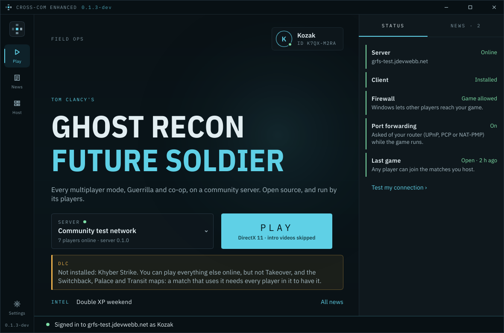

Without a pack, you can still play every base-game map and mode. **Quick Match only finds you lobbies your game can load**: Cross-Com's client tells the server which packs you have when you sign in, and the server leaves out lobbies that use a pack you're missing. (If a friend invites you into one anyway, the game itself refuses it with *"The host is using content that you have not yet downloaded"*.)

> [!NOTE]
> **We don't provide the game or its DLC, and can't help you get them.** Cross-Com only brings back the online services: you need your own copy of the game, and of any pack you want to play. Please don't ask for game files in issues or discussions.

  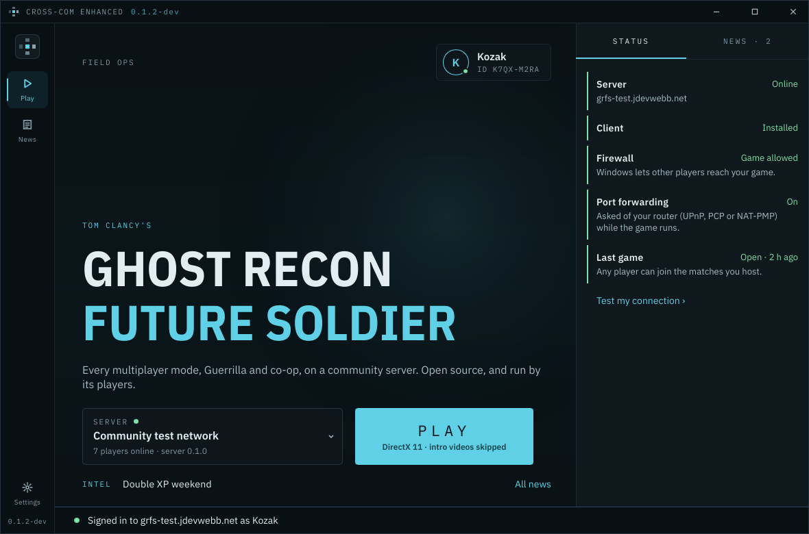

<table>
<tr>
<td>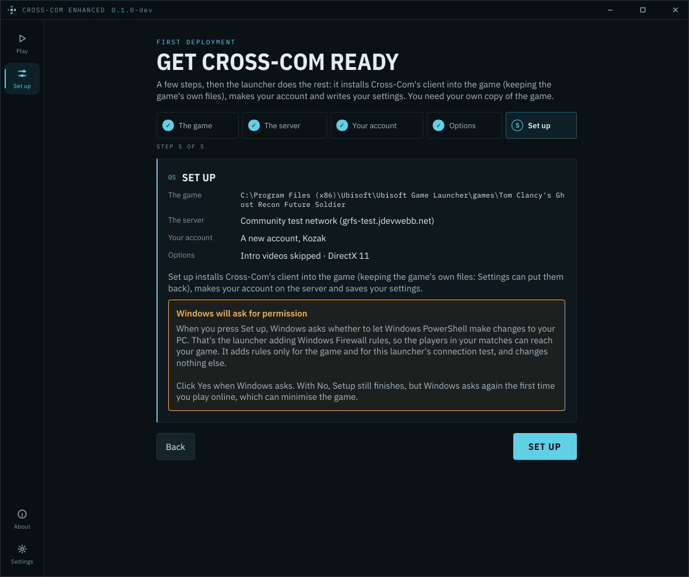</td>
<td>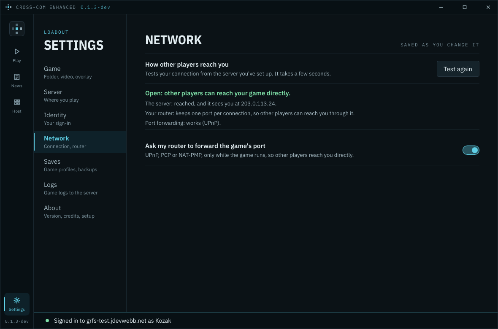</td>
</tr>
<tr>
<td align="center">The first launch's setup, a step at a time: your name, and no password</td>
<td align="center">Settings, a section at a time: the game, your server, identity and connection, your saves, the logs</td>
</tr>
</table>

### Your identity

Players have no password. The first time it runs, the launcher makes your **identity**: a key it keeps on your PC (in `%APPDATA%\Cross-Com`, encrypted for your Windows user). Your accounts belong to it: making one signs your chosen name with it, and signing in signs a message for that one server, which answers with a sign-in token for the game. So there's nothing to remember or type, and what a server is sent is no use for signing in as you anywhere else.

**Whoever has your identity can sign in as you**, so keep it to yourself. To play from another PC, open **Settings › Identity** on this one and press **Copy**, then on the other PC paste it into **Use an identity from another PC** and press **Use**. If that PC had an identity of its own, the launcher asks first, and keeps the one it replaces in its folder so it can be put back. A copy kept somewhere safe also keeps your accounts if this PC is lost.

The launcher screenshots show sample data.

### The in-game overlay

<kbd>F5</kbd> opens a panel over the game: the server's status and how many players are online, its news, **leaderboards for every player on the server**, by mode, and the **Lobby** tab: how many players the Quick Match or squad room you host needs before its countdown starts, and the most players the lobbies you make take (2 to 12). While it's open the game gets no mouse or keyboard; <kbd>F5</kbd> or <kbd>Esc</kbd> closes it.

<table>
<tr>
<td>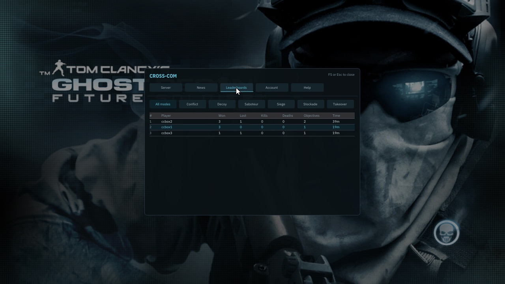</td>
<td>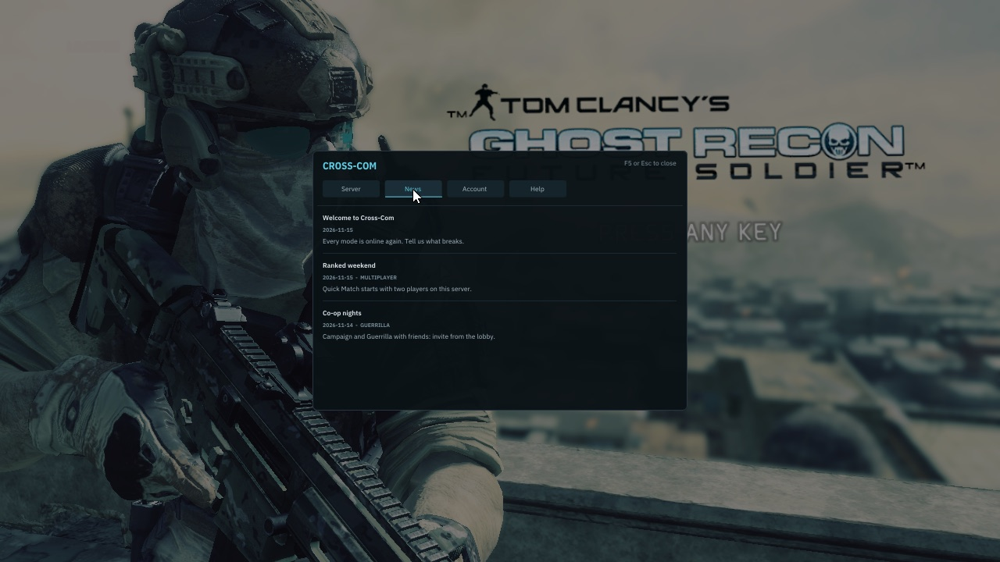</td>
</tr>
<tr>
<td align="center">Leaderboards, by mode</td>
<td align="center">The server's news</td>
</tr>
</table>

### Your connection

Matches are hosted by the players, so other players' games connect to yours. The server introduces you to each other and has both games open the way through your routers, which works for most home connections. While the game runs, Cross-Com also asks your router to **forward the game's port** to your PC (UPnP, PCP or NAT-PMP, if the router allows it), so other players can reach you whatever their own router does.

**Settings › Network › Test my connection** shows how reachable you are. It has the server send a packet to the port your router forwards, so Windows Firewall has to let the launcher receive it: Setup adds that rule with the game's (the same permission prompt), and a launcher you've moved since asks again.

- **Open:** other players can reach your game directly. Nothing to do.
- **Moderate:** you can play with most players. Two players whose routers are both strict may not reach each other.
- **Strict:** your router gives each connection a different port, so many players won't be able to reach you. Turn on **UPnP** in your router's settings (often under *Advanced* or *NAT*), then test again.
- **Blocked:** the game's traffic didn't reach the server: a firewall or the network you're on may block it.

While you play, the overlay's **Server** tab shows the same for the game itself (**Your connection**): whether the server could reach your game from outside, the forward your router made, and what to do if others can't reach you. A note pops up when that changes. The launcher's **Play** screen keeps what the last game found, next to whether Windows Firewall lets the game in and whether port forwarding is on.

If the test says another router or your internet provider is in front of yours (a *carrier-grade NAT*, common on mobile and some fibre and satellite connections), port forwarding can't help; your provider may give you a public address if you ask. The test's details say what it found; include them when you [report a problem](#reporting-a-problem) joining or hosting.

### Antivirus warnings

> [!WARNING]
> **Microsoft Defender removes `crosscom-launcher.exe` as soon as it's downloaded**, as `Trojan:Win32/Bearfoos.B!ml` (the `!ml` means a machine-learning guess, not a match with known malware). Put it back, then check it as below before you run it:
>
> 1. Open **Windows Security** › **Virus & threat protection** › **Protection history**.
> 2. Open the entry for `crosscom-launcher.exe`, choose **Actions** › **Restore**. Defender then leaves that file alone.
> 3. So updates and the game's files aren't removed later, go back to **Virus & threat protection** › **Manage settings** › **Exclusions** › **Add an exclusion** › **Folder**, and add the launcher's folder and the game's folder (the client DLLs it installs can be flagged too).
>
> Other antivirus programs may do the same; their quarantine has a restore too.

Antivirus programs, Microsoft Defender included, flag `crosscom-launcher.exe` or the client DLLs it installs. **These are false positives:** the client replaces two of the game's libraries and hooks the game so it can reach community servers, as cheats do, and the files aren't code-signed yet. Get the launcher only from this repository's [releases](https://github.com/JDevWebb/cross-com-enhanced/releases), where each file's VirusTotal results are listed, and check the release key's signature before you first run it: in Git Bash (it comes with Git for Windows), `scripts/verify-release.sh` from the release's tag checks the signature and every file at once ([Checking a download](docs/releasing.md#checking-a-download) says how, and where the key's fingerprint is published outside this repository). A matching hash alone isn't proof: `SHA256SUMS` sits on the same page as the files. After that, the launcher checks each update's signature itself.

### What's sent, and when

After each game you play online, the game's log from that run (`crosscom.log`, next to the game) is sent to the server you played on, so its host can see what went wrong. Before it's sent, your Windows user name and the game's sign-in token are taken out. The server takes logs only from players who have signed in to it from that PC, and keeps them for a limited time.

The launcher asks GitHub for the latest release when it starts and every few hours, to offer updates. That question carries only the launcher's version (GitHub sees your internet address, as with any download), and an update installs only when you press **Update**: the launcher checks the release's signature first.

When you [host a server](#host-a-server) for **anyone on the internet**, the launcher asks the community test network to check your server from outside: it sends only your server's port numbers, and the network sees your internet address (as for any connection) and tries those ports at it, once. Hosting for your network and VPN alone asks nothing.

**Settings › Logs › Send game logs after each game** turns it off. The logs stay in the game's `logs` folder either way, so you can still attach them to a report.

While you play online, the client also tells the server about your router: your PC's address on your home network, the port your router forwards to the game (if it does) and how it handles ports. The server gives the forwarded port to the players in your matches, the same way it already gives them your internet address. It also records how each join into a match went: how long the player stayed and both players' router details, by account and without addresses, kept for 90 days, so the server's host can see how often players can't reach each other. **Settings › Network** turns port forwarding off, and with it the router report. The connection test sends the same details, once, when you run it.

All of it goes over HTTPS, as signing in does; only a server on your own network or VPN without HTTPS is sent it unencrypted. Your identity itself never leaves your PC: servers get only your global id (its public half) and what it signs. Nothing else is collected.

## What works

Tested end to end on real copies of the game, on Windows 11 and under Wine on Linux, with up to four players, on one network and between home networks over the internet.

<table>
<tr><td><b>Ranked and player matches</b></td><td>Every adversarial mode: Conflict, Decoy, Saboteur, Siege, and the DLC modes Stockade (Arctic Strike) and Takeover (Khyber Strike). Every map is offered. A Quick Match starts with 2 players or more, not the game's own 8, so a quiet server still gets matches; **Settings › Game › Fewest players to start a match** changes it (2 to 12), and a lobby's host can change it for that lobby in the overlay's **Lobby** tab. Squad matches start with half that a side.</td></tr>
<tr><td><b>Co-op</b></td><td>The campaign and Guerrilla with friends, invited from the lobby.</td></tr>
<tr><td><b>Friends and parties</b></td><td>Friends lists, requests, invites into a lobby, the party following its host, and lobby chat.</td></tr>
<tr><td><b>Progression</b></td><td>XP, levels, unlocks, Gunsmith loadouts and stats, kept on the server; a friend's stats from View Player Stats.</td></tr>
<tr><td><b>Squads</b></td><td>Make a squad, invite, accept, ranks, the motto and message of the day. Squad parties (squadmates join from the Squad Parties list) and squad matches against other squads, with squad wins, XP and levels.</td></tr>
<tr><td><b>Multiplayer Challenges</b></td><td>The Daily Friend Challenge and Beat Your Best, and daring a friend back.</td></tr>
<tr><td><b>News</b></td><td>The server's own news in the main menu's Ghost Feed and on Community Messages.</td></tr>
<tr><td><b>Leaderboards</b></td><td>The game's own Leaderboards screen can't be opened on PC, so the overlay has its own: every player on the server, by mode.</td></tr>
<tr><td><b>Your own server</b></td><td>One click in the launcher's <b>Host</b> screen runs a server on your PC for friends on your network, a VPN or the internet, with a join code to send them. Or run the server on its own, on Windows or Linux. See <a href="#host-a-server">Host a server</a>.</td></tr>
<tr><td><b>Hosting matches</b></td><td>Players host their matches as they always did; the server introduces them, through home routers too, and the client asks your router to forward the game's port when it can. If the host leaves, the match moves to another player. <a href="#your-connection">Settings › Network</a> tests how reachable you are.</td></tr>
</table>

<table>
<tr>
<td>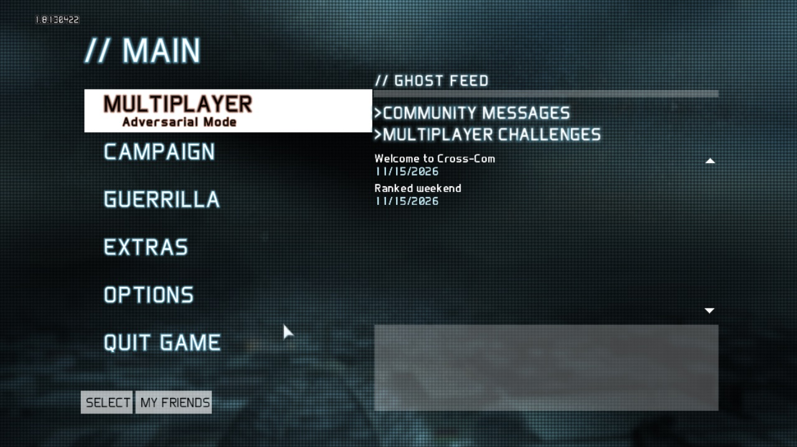</td>
<td>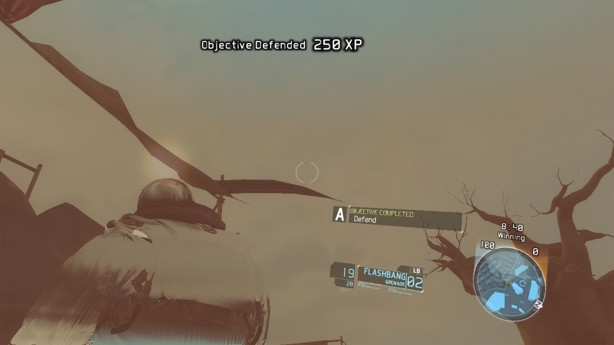</td>
</tr>
<tr>
<td align="center">The server's news in the Ghost Feed</td>
<td align="center">A ranked Conflict match</td>
</tr>
<tr>
<td>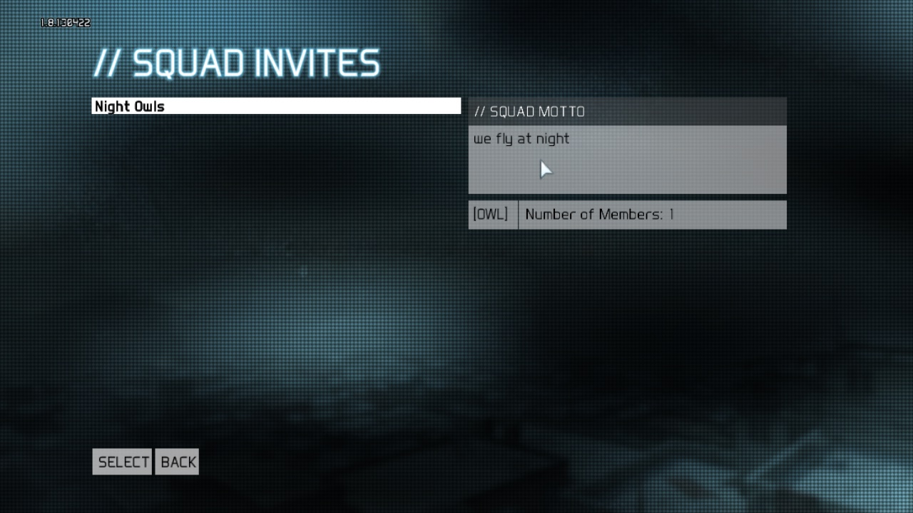</td>
<td>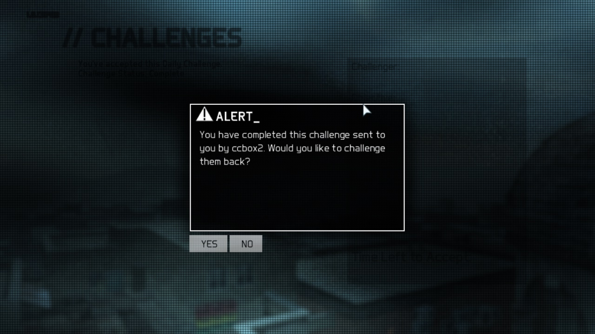</td>
</tr>
<tr>
<td align="center">Squads</td>
<td align="center">Multiplayer Challenges</td>
</tr>
</table>

**Not tested yet:** voice chat (it needs real microphones). It's on this build's test list.

**Known limitations:**

- **The game runs fullscreen only.** It has no windowed setting, and writes `Fullscreen True` back to its settings each time it starts.
- **A lobby's size is fixed when it's made.** The overlay's *Most players* applies to the lobbies you make next, so leave and make the lobby again to change it.

## Reporting a problem

[Open an issue](https://github.com/JDevWebb/cross-com-enhanced/issues/new/choose) (its forms ask for what each kind of problem needs) and say:

1. **What you did and what happened,** and roughly when (with your time zone).
2. **The server** you played on, and your account name.
3. **Your setup:** Windows version, Ubisoft Connect or Steam, DirectX 11 or 9.
4. **The log,** if it's not already on the server: `crosscom.log` and the `logs` folder, next to the game's exe.

Found a security problem? Please don't post it in a public issue: report it privately through the repository's **Security** tab. [SECURITY.md](SECURITY.md) says how, and what's in scope.

## Host a server

Your group can have a server of its own: its own accounts, stats, leaderboards and news. The matches still run on the players' PCs, so any PC will do.

**From the launcher, in one click.** The **Host** screen runs the server built into the launcher on your PC, while the launcher is open:

1. Choose **who can join**: *My network and VPN* (nothing opened on your router), or *Anyone on the internet with a join code*.
2. Press **Start server**. The launcher lets it through Windows Firewall (Windows asks once), and for the internet asks your router to forward its ports (UPnP, PCP or NAT-PMP), then has the community test network check it can be reached from outside.
3. **Copy** a join code and send it to your friends: one for the internet, one for your network, one for your VPN (Tailscale). They paste it in their launcher's server box.
4. **Play on my server** sets your own game up to play there too.

  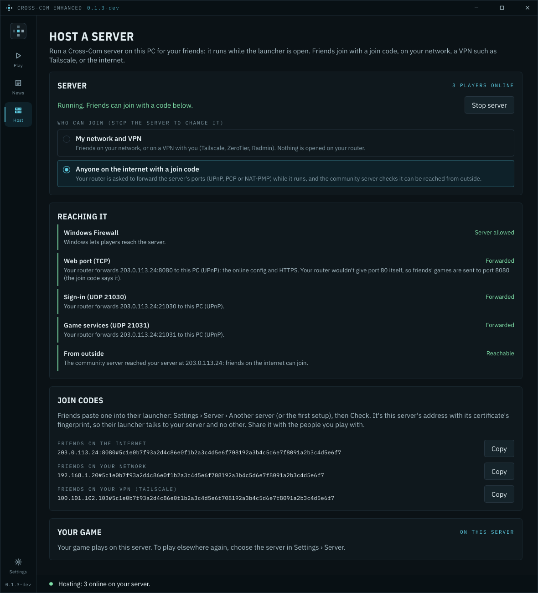

A join code is the server's address, its port, and its own HTTPS certificate's fingerprint: no domain or certificate to buy, and your friends' launchers talk to your server and no other, encrypted. The port can be any your router gives (many won't forward port 80): Cross-Com's client sends the game there.

**On its own.** `crosscom-server-windows-x86_64.exe` runs the server on a Windows PC without the launcher (at startup too, with Task Scheduler), and the server runs in Docker on any small Linux machine or VPS, or as a single program. With its own certificate, players join with a join code; with a domain, Caddy gives it HTTPS from Let's Encrypt in one more compose file, and one machine can host this server and a [5th Echelon Enhanced](https://github.com/JDevWebb/5th-echelon-enhanced) server side by side.

**[The wiki's hosting pages](https://github.com/JDevWebb/cross-com-enhanced/wiki/Hosting-a-Server)** take you through each way: [from the launcher](https://github.com/JDevWebb/cross-com-enhanced/wiki/Hosting-from-the-Launcher), [join codes](https://github.com/JDevWebb/cross-com-enhanced/wiki/Join-Codes), [port forwarding and routers](https://github.com/JDevWebb/cross-com-enhanced/wiki/Port-Forwarding-and-Routers), [Windows](https://github.com/JDevWebb/cross-com-enhanced/wiki/Windows-Dedicated-Server), [Linux and Docker](https://github.com/JDevWebb/cross-com-enhanced/wiki/Linux-and-Docker-Server), [every setting](https://github.com/JDevWebb/cross-com-enhanced/wiki/Server-Settings) and [what to do when something's wrong](https://github.com/JDevWebb/cross-com-enhanced/wiki/Server-Troubleshooting). **[docs/hosting.md](docs/hosting.md)** has the server's reference: its API, players' logs and connection records.

## How it works

Future Soldier's PC version talks to Ubisoft's Quazal-based online services, the same family *Splinter Cell: Blacklist* uses. Cross-Com Enhanced answers in their place:

- **The server** speaks the game's online protocols: sign-in, profiles and stats, matchmaking and sessions, friends, squads, challenges, news and NAT traversal. Its HTTP side gives the game its online config, and the launcher and overlay their API.
- **The client DLLs** replace the game's two Ubisoft libraries, so the game signs in to a Cross-Com server, and carry the in-game overlay.
- **The launcher** finds the game, installs the client, signs you in and starts the game, and can host a server for your friends.

Matches themselves are still hosted by the players, as they always were.

## Documentation

| For | Where |
|---|---|
| **Help and guides** | [The wiki](https://github.com/JDevWebb/cross-com-enhanced/wiki): getting started, every launcher screen and setting, your connection, hosting a server, troubleshooting and error messages |
| **Hosting a server** | [The wiki's hosting pages](https://github.com/JDevWebb/cross-com-enhanced/wiki/Hosting-a-Server), and [docs/hosting.md](docs/hosting.md): Docker or not, Windows, settings, accounts, news, HTTPS with Caddy or of its own (join codes), sharing a machine, the API, players' logs |
| **The client** | [client/README.md](client/README.md): what the DLLs do, the overlay, `crosscom.toml` |
| **The protocols** | [docs/protocol.md](docs/protocol.md): what the server answers, worked out from the game |
| **Releases** | [docs/releasing.md](docs/releasing.md): checking a download (checksums, the release key's signature, build provenance, VirusTotal), how releases are built, signed and published, and CI |
| **Building** | `scripts/build-launcher.sh` builds the client DLLs, the Windows server and the launcher (`launcher-slint/`, with both built in) into `dist/crosscom-launcher.exe` and `dist/crosscom-server.exe` (in Docker); `scripts/check.sh` runs the formatting, lints and tests; `scripts/launcher-shots.sh` redraws the launcher screenshots |

## Standing on the shoulders of

Cross-Com Enhanced is developed by [JDevWebb](https://github.com/JDevWebb), as a sister project to [5th Echelon Enhanced](https://github.com/JDevWebb/5th-echelon-enhanced) for Splinter Cell: Blacklist.

- **[5th Echelon Enhanced](https://github.com/JDevWebb/5th-echelon-enhanced)**, this project's starting point: `quazal/` and `tools/quazal-tools/` came from it with its fixes and their history, and the release process (signed releases, build provenance and VirusTotal scans), the CI and the issue forms are adapted from its own.
- **[unixoide](https://github.com/unixoide)** wrote [5th Echelon](https://github.com/unixoide/5th-echelon) and its Quazal implementation (PRUDP, RMC, Kerberos tickets), which `quazal/` is built on, with its history and authors kept. Also by its contributors Matthias Walther, koteykaby and Askorbinovaya Kislota.
- **[Phoenix Network](https://github.com/Phoenix-Network-Ltd/Ghost-Recon-Future-Soldier-Research)** (Michał Kapała): the first Future Soldier backend research, which worked out much of the sign-in and recorded what the official servers answered, such as the players' privileges.
- **[zeroKilo](https://github.com/zeroKilo)** and **[Michał Kapała](https://github.com/michal-kapala)**: [GROBackendWV](https://github.com/zeroKilo/GROBackendWV), a Ghost Recon Online backend on the same online stack.
- **[Kinnay](https://github.com/Kinnay)**: the [PRUDP documentation](https://github.com/Kinnay/NintendoClients/wiki/PRUDP-Protocol).

Also used: [IBM Plex](https://github.com/IBM/plex) Sans, Sans Condensed and Mono (SIL Open Font License) for the launcher and overlay, [Slint](https://slint.dev) for the launcher (under its royalty-free licence for desktop apps), [hudhook](https://github.com/veeenu/hudhook) with [Dear ImGui](https://github.com/ocornut/imgui) for the overlay, and [Caddy](https://caddyserver.com) for HTTPS.

## Contributing

Testing reports are the most useful thing right now: play with friends and [report what breaks](#reporting-a-problem). Research, documentation and code are welcome too:

- **Pull requests:** keep them focused, and say how you tested (the pull request's checklist asks). Run `scripts/check.sh` first, and `scripts/bots.sh` for server changes. Changes that affect the game should say whether they were tried in the game itself.
- **Research:** write what you worked out in your own words. Game files, extracted game data and disassembly can't go in this repository.
- **Servers:** running one for your group is one of the best ways to help: the launcher's **Host** screen makes it one click.

## Licence

Cross-Com Enhanced's own work is under the MIT licence. The code from upstream 5th Echelon isn't licensed by its authors yet. [LICENSE.md](LICENSE.md) says exactly which is which.

Ghost Recon: Future Soldier is a trademark of Ubisoft Entertainment. This project isn't affiliated with Ubisoft and contains no game files: you need your own copy of the game. The screenshots show the game running with Cross-Com.
